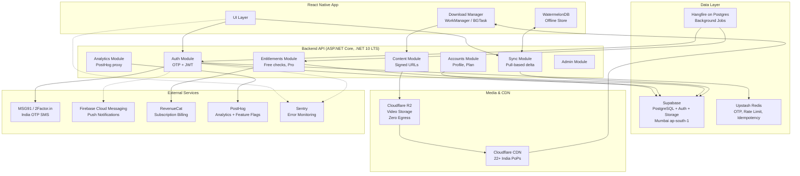

# CasaFit backend demands a hybrid India-first infrastructure stack

For a 15-minute home-workout app targeting India's price-sensitive, mobile-first market, the architecture decision hinges on three forces pulling in different directions: **India data residency under the DPDP Act**, **near-zero launch costs** using permanent free tiers, and **CDN bandwidth as the dominant cost driver** once workout videos scale past 1 TB/month. After synthesizing hosting, database, cache, storage, CDN, auth, billing, analytics, and monitoring options across Azure, AWS, and budget/startup providers, the clearest path forward is a hybrid stack: **Supabase Pro (Mumbai) for database + auth + storage of user data, Cloudflare R2 for video assets with zero egress, an ASP.NET Core API (.NET 10 LTS) on AWS App Runner or Azure Container Apps (Mumbai), Upstash for serverless Redis (with Hangfire on Postgres for background jobs), MSG91 or 2Factor.in for India OTP, FCM for push, RevenueCat for subscriptions, PostHog for analytics, and Sentry for error monitoring.** This hybrid approach costs roughly **$5-10/month at launch**, **$70-120/month at 10K users**, and **$300-600/month at 100K users** -- 40-60% cheaper than a pure Azure stack and 30-50% cheaper than full AWS, while meeting India data residency requirements for the API and database layers.

---

# Part 1: High-Level Architecture Overview

## The current system connects a React Native app through OTP-authenticated APIs to Supabase and media storage

CasaFit's architecture follows a standard mobile-backend pattern. The **React Native app** (targeting Android-first for India) communicates with a **backend API** (ASP.NET Core on .NET 10 LTS, replacing the earlier NestJS scaffold) that handles authentication, business logic, subscription management, and content delivery. The backend connects to **PostgreSQL via Supabase** for user data, profiles, workout plans, food logs, and session history. **Redis (Upstash)** handles OTP code storage with 5-minute TTL, rate limiting, and idempotency keys. **Object storage + CDN** delivers workout demo videos (10-30 second MP4 clips) and exercise thumbnails. The app uses a **pull-based sync architecture**: each device calls a sync endpoint on app open, the server returns changes since the last sync timestamp, and the client merges locally using WatermelonDB as the offline-first local database ([Supabase Blog: React Native Offline-First](https://supabase.io/blog/react-native-offline-first-watermelon-db)).

The **OTP + JWT login system** works as follows: the user submits their phone number, the server generates a 6-digit code with a 5-minute TTL stored in Redis, sends it via SMS (MSG91 or 2Factor.in), and upon verification issues a **short-lived JWT access token (15 minutes)** and a **long-lived refresh token (30 days)** stored in a `device_sessions` table. Each device gets its own independent token pair, enabling per-device session management. Refresh token rotation invalidates each token after single use; replay detection revokes the entire token family. For CasaFit's 7-day offline grace period, the 30-day refresh token TTL ensures devices coming back online can silently re-authenticate. **Multi-device sync** is pull-based: each device calls `GET /sync?since=<timestamp>` on app open, and the server returns deltas for workout progress, food logs, step summaries, session logs, free-check balance (server-authoritative with idempotency keys), and Pro subscription status (server-authoritative via receipt validation).

**Images and videos** follow an offline-first download strategy. The API returns a JSON session-pack manifest listing all exercise clips at multiple quality levels (360p/480p/720p H.264 MP4). The app downloads clips in the background on Wi-Fi using platform download managers (WorkManager on Android, BGTaskScheduler on iOS). For Pro content, short-lived **signed URLs (1-4 hours)** gate the download; once downloaded, the file persists locally. Thumbnails are pre-generated at upload time in three sizes (150x150, 400x300, 800x600 WebP) and served with aggressive CDN caching (`Cache-Control: public, max-age=31536000, immutable`).



## ASP.NET Core on .NET 10 LTS is the chosen backend, and it changes the runtime but not the architecture

The product owner has chosen ASP.NET Core for the backend, replacing the NestJS scaffold. The two frameworks share remarkably similar patterns -- attribute-routed controllers, constructor-injected services, and middleware pipelines -- so the architecture, hosting, data and cost analysis in this report apply unchanged ([TypeScript is Like C#](https://typescript-is-like-csharp.chrlschn.dev/pages/intermediate/nest-vs-controller-api)). The NestJS `@Module()` decorator maps to `IServiceCollection` extension methods (one `AddXxxModule()` per feature); NestJS Guards map to authorization policies and `IAuthorizationHandler`; NestJS Pipes (class-validator) map to FluentValidation; NestJS Exception Filters map to `IExceptionHandler` with RFC 9457 `ProblemDetails` ([Leapcell Blog](https://leapcell.io/blog/empowering-backend-development-with-ioc-containers-in-nestjs-and-asp-net-core)). The project structure follows Clean Architecture: `CasaFit.Api` (controllers, `Program.cs`), `CasaFit.Application` (services, validators), `CasaFit.Domain` (entities, interfaces) and `CasaFit.Infrastructure` (EF Core `DbContext`, Redis, external APIs), plus `CasaFit.UnitTests` and `CasaFit.IntegrationTests`. The six modules are feature folders inside those projects, not separate services.

**Target .NET 10 LTS, not 8.** .NET 8 LTS leaves support in November 2026, so a service started now should begin on .NET 10 (supported to November 2028).

For the OTP + JWT auth flow, ASP.NET Core's built-in `AddAuthentication().AddJwtBearer()` middleware validates tokens on every request, with a fallback policy that requires authentication unless an endpoint opts out with `[AllowAnonymous]`. OTP generation and verification and token issuance live in a custom `AuthService`, mirroring the NestJS approach with `@nestjs/jwt` and `passport-jwt`. **ASP.NET Identity is unnecessary** for an OTP-only flow; it assumes password-based authentication at its core. **Entity Framework Core** with the Npgsql provider replaces Prisma for PostgreSQL access, providing code-first migrations, change tracking and LINQ queries. For background jobs, **Hangfire** with PostgreSQL storage (free, open-source) replaces BullMQ, offering fire-and-forget jobs, delayed execution, recurring jobs and a built-in dashboard ([BoldSign Blog](https://boldsign.com/blogs/aspnet-core-background-jobs-hosted-services-hangfire-quartz/)). Hangfire needs one warm instance, so price the host with a minimum of one running instance; Upstash QStash (HTTP push) remains the option if that always-on cost becomes material. Built-in `AddRateLimiter` covers per-IP limits, with Redis counters for per-number and per-device send limits, and `Microsoft.AspNetCore.OpenApi` generates the OpenAPI document.

**What the switch buys:** better raw performance (ASP.NET Core consistently outperforms NestJS in TechEmpower benchmarks), stronger compile-time type safety on the entitlement and billing paths, and a native Azure path with first-class Application Insights and Container Apps tooling.

**What it costs, and how the project absorbs it:**

- **A full rewrite of the scaffolded `api/`.** There is no automated migration path. Nothing is deployed, so the cost is the work already done on the first slice (`POST /v1/auth/code` and `/v1/auth/verify`), which is ported rather than extended.
- **No shared TypeScript package with the app.** The API publishes an OpenAPI document and `shared/` generates the app's request and response types from it. Identifier normalisation (phone to E.164, email canonicalisation) exists in both languages and both run the same JSON test vectors, so the two implementations cannot drift.
- **No official RevenueCat .NET SDK.** The server only needs webhooks plus a REST lookup through a typed `HttpClient`; the app keeps the official React Native SDK. App Store receipts use Apple's `app-store-server-library-dotnet` and Google Play uses `Google.Apis.AndroidPublisher.v3`.
- **App Attest has no official server library for .NET.** Budget a small, well-tested validator (CBOR plus certificate chain) and spike it before the onboarding backend tasks. Play Integrity decoding has an official Google client.
- **A smaller pool of affordable .NET backend developers in India** than Node.js/TypeScript. Keep the service conventional and well documented.
- **Slower cold starts for scale-to-zero hosts** (mitigated by keeping one warm instance, which Hangfire needs anyway, and by Native AOT where it fits).

## Three stack options serve different stages and budget constraints

The architecture diagrams below show how the same logical components map to three different infrastructure configurations. The core app logic, data flow, and auth system remain identical across all three -- only the hosting providers and service choices change.

### Stack A: Azure-based

```
┌─────────────────────────────────────────────────────────┐
│                    AZURE STACK (India)                    │
├─────────────────────────────────────────────────────────┤
│                                                          │
│  React Native App                                        │
│       │                                                  │
│       ▼                                                  │
│  Azure App Service (B1, Central India/Pune)              │
│  ASP.NET Core API  ─── $13/mo (Growth)                  │
│       │          │          │          │                  │
│       ▼          ▼          ▼          ▼                  │
│  Azure DB     Azure Cache  Azure Blob  Azure             │
│  for Postgres for Redis    Storage     Notification      │
│  Flex B1ms    Basic C0     Hot Tier    Hubs              │
│  ~$15/mo      ~$17/mo      ~$1/mo     $0-10/mo          │
│       │                       │                          │
│       │                       ▼                          │
│       │                  Azure Front Door                │
│       │                  India CDN                        │
│       │                  ~$0.109/GB                       │
│       │                                                  │
│  External: MSG91 (SMS), RevenueCat, PostHog, Sentry     │
└─────────────────────────────────────────────────────────┘
  Launch: ~$37-40/mo │ Growth: ~$165-222/mo │ Scale: ~$710-1,365/mo
```

### Stack B: AWS-based

```
┌─────────────────────────────────────────────────────────┐
│                    AWS STACK (India)                      │
├─────────────────────────────────────────────────────────┤
│                                                          │
│  React Native App                                        │
│       │                                                  │
│       ▼                                                  │
│  AWS App Runner / ECS Fargate (Mumbai ap-south-1)       │
│  ASP.NET Core API  ─── $5-25/mo                         │
│       │          │          │          │                  │
│       ▼          ▼          ▼          ▼                  │
│  AWS RDS      ElastiCache  S3 Mumbai   FCM               │
│  PostgreSQL   Redis        Standard    (Free)            │
│  t4g.micro    t4g.micro    $0.025/GB                    │
│  ~$15/mo      ~$14/mo      ~$1/mo                       │
│       │                       │                          │
│       │                       ▼                          │
│       │                  CloudFront                      │
│       │                  1 TB/mo FREE                    │
│       │                  India PoPs: 7 cities            │
│       │                                                  │
│  External: MSG91 (SMS), RevenueCat, PostHog, Sentry     │
└─────────────────────────────────────────────────────────┘
  Launch: ~$8-10/mo │ Growth: ~$136-199/mo │ Scale: ~$684-1,179/mo
```

### Stack C: Budget/Startup (Recommended Hybrid)

```
┌─────────────────────────────────────────────────────────┐
│              BUDGET/HYBRID STACK (India)                  │
├─────────────────────────────────────────────────────────┤
│                                                          │
│  React Native App (WatermelonDB offline store)          │
│       │                                                  │
│       ▼                                                  │
│  AWS App Runner / Azure Container Apps (Mumbai)         │
│  ASP.NET Core API  ─── $5-7/mo (launch) to $25-30/mo   │
│       │          │          │          │                  │
│       ▼          ▼          ▼          ▼                  │
│  Supabase     Upstash     Cloudflare  FCM                │
│  Pro (Mumbai) Redis       R2          (Free)             │
│  $25/mo       $0-5/mo     $0.015/GB                     │
│  DB+Auth+     Serverless  ZERO EGRESS                   │
│  Storage      OTP/Cache                                  │
│       │                       │                          │
│       │                       ▼                          │
│       │                  Cloudflare CDN                  │
│       │                  FREE plan                        │
│       │                  22+ India PoPs                  │
│       │                                                  │
│  External: MSG91/2Factor (SMS), RevenueCat,             │
│           PostHog, Sentry                                │
└─────────────────────────────────────────────────────────┘
  Launch: ~$2-7/mo │ Growth: ~$99-182/mo │ Scale: ~$473-1,099/mo
```

---

# Part 2: Components Alternatives and Pricing

## Backend hosting: Azure and GCP offer the easiest .NET path, but App Runner wins on simplicity

Backend compute is the first architectural decision, and India data residency immediately eliminates Railway and Render -- neither has Indian regions, with Singapore as the closest option adding 100-150 ms latency and failing DPDP Act compliance ([Render Docs](https://render.com/docs/regions); [Railway Feedback](https://station.railway.com/feedback/request-an-india-region-for-railway-df4af9f2)).

**Azure App Service** provides first-class .NET support with three India regions (Pune, Chennai, Mumbai). The Free F1 tier is barely usable for production (60 CPU minutes/day, no custom domain SSL), but Basic B1 at **~$13/month** (1 core, 1.75 GB RAM) handles early production traffic. Azure Container Apps offers a generous free grant of **180,000 vCPU-seconds/month** with scale-to-zero, making it arguably the best free-tier option for .NET ([Azure Pricing](https://azure.microsoft.com/en-gb/pricing/details/container-apps/)). At scale, Standard S2 runs **~$100/month** for 2 cores and auto-scaling.

**AWS App Runner** in Mumbai (ap-south-1) scales to near-zero when idle at **~$5-7/month** for minimal traffic, making it the cheapest always-available option with India data residency. **ECS Fargate** provides more control at **~$25/month** (0.5 vCPU, 1 GB) for steady traffic, scaling to **~$70-90/month** for load-balanced dual-task production. ARM (Graviton) instances save ~20% on Fargate, and .NET runs well on ARM ([AWS Fargate Pricing](https://aws.amazon.com/fargate/pricing/)).

**Google Cloud Run** in Mumbai (asia-south1) has a generous free tier (240,000 vCPU-seconds/month) and Tier 1 pricing. Its scale-to-zero model means you pay nothing during idle periods. Always-on 1 vCPU runs **~$50-65/month** before free tier credits. **Cold start latency** (3-5 seconds for .NET JIT) can be mitigated with min-instances=1 or .NET AOT compilation ([Cloud Run Pricing](https://cloud.google.com/run/pricing)).

For self-hosted options, **Coolify on a DigitalOcean Droplet in Bangalore (BLR1)** at **~$12/month** (1 vCPU, 2 GB) gives a Heroku-like deployment experience at VPS prices with full data residency control.

| Platform | India Region | Launch Cost | Growth Cost | Scale Cost | .NET Support |
|----------|-------------|------------|------------|-----------|-------------|
| Azure App Service | Yes (3 regions) | $0 (F1) | $13 (B1) | $100 (S2) | Native |
| Azure Container Apps | Yes (3 regions) | $0 (free grant) | ~$20 | ~$63 | Docker |
| AWS App Runner | Yes (Mumbai) | $5-7 | $25 | $70-90 | Docker |
| Google Cloud Run | Yes (Mumbai, Delhi) | $0 (free tier) | ~$30 | ~$55 | Docker |
| Coolify + DO BLR1 | Yes (Bangalore) | $6-12 | $12-24 | $24-48 | Docker |
| Railway | No (Singapore) | $5 | $25-30 | $60-80 | Docker |
| Render | No (Singapore) | $0 (spin-down) | $7 | $25 | Docker |

## Database options: Supabase Pro in Mumbai delivers the best value-to-effort ratio

**Supabase Pro at $25/month** is the strongest database choice for CasaFit. It bundles PostgreSQL (8 GB disk), authentication (100K MAUs), file storage (100 GB), edge functions (2M invocations), realtime subscriptions, and connection pooling via Supavisor -- all in one service that reportedly launched Mumbai (ap-south-1) as a primary region in November 2025 ([Rohit Raj Tech Blog](https://rohitraj.tech/notes/supabase-vs-firebase-india-mvp-2026)). The free tier works for development but **pauses projects after 1 week of inactivity**, making it unsuitable for production ([Supabase Pricing](https://supabase.com/pricing)). At scale, compute add-ons range from Micro ($10/month, shared vCPU, 1 GB RAM) to Large ($110/month, 2 dedicated vCPU, 8 GB RAM). MAU overage beyond 100K costs **$0.00325/MAU**, so a 500K-user app adds ~$1,300/month in MAU charges alone.

**AWS RDS PostgreSQL** in Mumbai starts at **~$15/month** for db.t4g.micro (2 vCPU, 1 GB RAM) plus ~$2.66/month for 20 GB gp3 storage. New accounts get a 12-month free tier (750 hours/month of db.t3.micro) ([AWS RDS Free Tier](https://aws.amazon.com/rds/free/)). RDS offers full PostgreSQL control but no built-in auth, storage, or realtime -- you build those yourself. Connection pooling requires **RDS Proxy ($0.015/vCPU-hour)** or self-managed PgBouncer ([Bytebase DB Cost](https://www.bytebase.com/dbcost/rds/instance/db.t4g.micro/)).

**Azure Database for PostgreSQL Flexible Server** in Central India starts at **~$15/month** (B1ms, 1 vCPU, 2 GB RAM) with built-in PgBouncer -- an advantage over RDS. General Purpose D2ds_v5 for production runs **~$130-150/month** ([Bytebase Azure Pricing](https://www.bytebase.com/dbcost/azure-flexible-server-pricing/)).

**Neon** offers serverless Postgres with scale-to-zero at **$0/month** (free, 0.5 GB) or **~$19/month** (Launch, 10 GB), but India region availability is **unconfirmed** -- a critical blocker for DPDP compliance ([Neon Pricing](https://neon.tech/pricing)). **CockroachDB Basic** has a generous free allotment (50M Request Units + 10 GB/month), but India region is also unconfirmed and its distributed architecture is overkill for CasaFit ([CockroachDB Pricing](https://www.cockroachlabs.com/docs/cockroachcloud/learn-about-pricing.html)).

| Database | Mumbai Region | Launch | Growth | Scale | Includes Auth/Storage |
|----------|-------------|--------|--------|-------|----------------------|
| Supabase Pro | Yes | $0 (free tier) | $25 | $75-150 | Yes (all-in-one) |
| AWS RDS | Yes | $0 (12-mo free) | $25-30 | $120-150 | No |
| Azure Flex Server | Yes | $15 | $25-30 | $130-150 | No |
| Neon | Unconfirmed | $0 | $19 | Usage-based | No |
| Google Cloud SQL | Yes | ~$35-50 | ~$50 | ~$100+ | No |

## Cache and queues: Upstash serverless Redis eliminates management overhead at near-zero cost

**Upstash Redis** is the standout cache option for a startup. Its free tier provides **256 MB, 500K commands/month, and 10 GB bandwidth** with no credit card required. At CasaFit's scale, a simple OTP flow (SET + GET + DEL = 3 commands per OTP) at 10K OTPs/day consumes 900K commands/month, costing just **~$1.80/month** on pay-as-you-go ($0.20/100K commands). Upstash reportedly uses uniform pricing across all regions including ap-south-1 (Mumbai) ([Upstash Billing Docs](https://upstash.com/docs/redis/overall/billing); [SelfHost.dev](https://selfhost.dev/blog/managed-redis-pricing-comparison/)).

**Upstash QStash** is the serverless alternative to Hangfire's in-process worker: an HTTP-based message queue that pushes messages to your endpoints, eliminating always-on worker processes. The default is Hangfire on the existing Postgres, which needs no extra service; QStash is the fallback if holding one warm instance becomes a material cost. The free tier handles **1,000 messages/day**, and pay-as-you-go costs **$1 per 100K messages**. At 10K daily sync jobs, that is 300K messages/month or **~$3/month** ([Upstash QStash Pricing](https://upstash.com/pricing/qstash)).

**AWS ElastiCache** in Mumbai starts at **~$13-16/month** for cache.t4g.micro (0.5 GB). It offers the lowest latency for AWS-hosted backends but requires VPC configuration and has **no free tier**. The newer Valkey option (Redis fork) saves ~20% over Redis OSS on the same node types ([Upstash Blog](https://upstash.com/blog/aws-elasticache-pricing-explained-2026-full-cost-breakdown)).

**Azure Cache for Redis** Basic C0 starts at **~$17/month** with no SLA and shared CPU (dev/test only). Standard C0 with replication costs **~$40/month**. Azure Cache for Redis is being retired September 2028; Microsoft recommends Azure Managed Redis for new deployments ([Azure Cache Pricing](https://azure.microsoft.com/en-us/pricing/details/cache/)).

| Cache/Queue | Mumbai | Launch | Growth | Scale | Free Tier |
|-------------|--------|--------|--------|-------|-----------|
| Upstash Redis | Likely (ap-south-1) | $0 | $3-8 | $10-30 | 500K cmds/mo |
| Upstash QStash | Global (push-based) | $0 | $1-3 | $10-20 | 1K msgs/day |
| AWS ElastiCache | Yes | $13-16 | $20-25 | $80-100 | None |
| Azure Cache Redis | Yes (Central India) | $17 | $40 | $52-80 | None |
| Self-hosted Dragonfly | Any Indian VPS | $8-10 (VM) | $10-15 | $15-24 | OSS free |

## Object storage + CDN: Cloudflare R2's zero egress saves hundreds per month for a video-heavy app

CDN bandwidth is the **dominant variable cost** for a fitness app streaming workout videos. At 100K users each downloading ~200 MB/month of video content, that is ~20 TB/month of CDN delivery. The difference between providers at this scale is stark:

**Cloudflare R2 + Cloudflare CDN** stores video at **$0.015/GB-month** with **zero egress fees** -- the entire 20 TB/month costs nothing in bandwidth. R2 has no India-specific storage region (nearest is APAC/Singapore), but Cloudflare's CDN network has **22+ Indian city PoPs** including Mumbai, Delhi, Bangalore, Chennai, and Hyderabad, so cached content serves locally ([Cloudflare R2 Pricing](https://developers.cloudflare.com/r2/pricing); [Cloudflare blog](https://blog.cloudflare.com/cloudflare-launches-in-india-with-data-centers-in-mumbai-chennai-and-new-delhi/)). At 50 GB storage + 500 GB egress, the total cost is **~$0.93/month**. At 500 GB storage + 20 TB egress, it is still only **~$7.50/month**.

**AWS S3 + CloudFront** benefits from CloudFront's always-free 1 TB/month data transfer, making it **effectively free at launch** (~$1.25/month for S3 storage alone). Beyond 1 TB, CloudFront's India rate is **$0.109/GB** for the first 10 TB ([AWS CloudFront Pricing](https://aws.amazon.com/cloudfront/pricing/)). S3 Mumbai storage costs **$0.025/GB-month** ([TechPlained](https://www.techplained.com/r2-vs-s3-vs-bunny-india)). At 20 TB/month, CDN delivery alone costs **~$1,748/month** -- 230x more than Cloudflare R2.

**Bunny Storage + Bunny CDN** offers the simplest all-in-one setup with transparent pricing. Storage costs **$0.01/GB-month** (cheapest raw storage), and CDN delivery to India is **$0.03/GB** on the Standard tier. Five Indian PoP cities (Bangalore, Chennai, Kolkata, Mumbai, New Delhi) provide good coverage ([Bunny CDN Pricing](https://bunny.net/docs/cdn/pricing.md)). At 500 GB egress, total cost is **~$16/month** -- more than R2 but simpler to manage.

**Backblaze B2 + Cloudflare** via the Bandwidth Alliance provides the absolute cheapest option at **~$0.30/month** (50 GB storage, free egress through Cloudflare). However, B2 has **no Asia storage region** (US/EU only), adding 150-250 ms origin latency before CDN caching ([Backblaze B2 Pricing](https://www.backblaze.com/b2/cloud-storage-pricing.html)).

| Bundle | 50 GB + 500 GB/mo | 500 GB + 5 TB/mo | 500 GB + 20 TB/mo | India PoPs |
|--------|-------------------|-------------------|---------------------|------------|
| R2 + Cloudflare CDN | **$0.93** | **$7.50** | **$7.50** | 22+ cities |
| S3 + CloudFront | $1.25 (free CDN) | $440 | $1,760 | 7+ cities + 46 embedded |
| Bunny Storage + CDN | $16 | $151 | $601 | 5 cities |
| B2 + Cloudflare | $0.30 | $3 | $3 | 22+ cities (CDN) |
| Azure Blob + Front Door | $41 | ~$550 | ~$2,200 | Varies by tier |

## SMS OTP for India: 2Factor.in and MSG91 cost one-third of Twilio

Indian SMS regulations require **DLT (Distributed Ledger Technology) registration** with TRAI-compliant sender IDs and template approval before sending any transactional SMS. This one-time setup takes 2-3 weeks regardless of provider. **Azure Communication Services does not support SMS to India at all** ([Microsoft Q&A](https://learn.microsoft.com/en-us/answers/questions/2124468/azure-sms-services-for-india-region)), so all three stack options must use an India-specific SMS provider.

**2Factor.in** offers the lowest per-OTP cost at **~INR 0.12/SMS (~$0.0014)** with free end-to-end DLT onboarding including scrubbing, template approval, and sender-ID go-live. WhatsApp authentication messages pass through at Meta's rate (~INR 0.115) with zero platform markup ([2Factor.in](https://2factor.in/v4/index.html)). **MSG91** costs **~INR 0.15/SMS (~$0.0018)** with a more mature API ecosystem, auto-retry, and voice OTP fallback. Failed API messages are not charged ([MSG91 Help](https://msg91.com/help/all-service-deductions-)). **Gupshup** at **~INR 0.17/SMS** is the strongest choice for WhatsApp-first OTP delivery, being a Meta Business Partner. **Twilio Verify** is the most expensive at **~INR 0.45/OTP (~$0.0054)** -- 3x the cost of Indian alternatives -- with self-service DLT registration that adds complexity ([Message Central Blog](https://www.messagecentral.com/blog/twilio-verify-alternative-india)).

WhatsApp OTP as a fallback channel is worth implementing: delivery is more reliable than SMS in India, and at ~INR 0.12/message it is cheaper than SMS for some providers ([Fyno Blog](https://fyno.io/blog/how-to-save-big-on-sms-costs-with-whatsapp-in-india-updated-clst1n275005yxv47ioyo7mff)).

| Provider | Per-OTP (INR) | Per-OTP (USD) | DLT Support | WhatsApp OTP | Best For |
|----------|-------------|-------------|-------------|--------------|----------|
| 2Factor.in | ~0.12 | ~$0.0014 | Free setup | Yes (Meta rate) | Budget startup |
| MSG91 | ~0.15 | ~$0.0018 | Included | Yes | Mature API |
| Gupshup | ~0.17 | ~$0.0020 | Included | Yes (strong) | WhatsApp-first |
| Twilio Verify | ~0.45 | ~$0.0054 | Self-serve | Yes | Global apps |

## Push notifications, billing, analytics, and monitoring round out the stack

**Push notifications:** FCM is completely free with no published usage caps and is baked into Google Play Services on every certified Android device in India -- the only sensible choice for CasaFit's Android-first market ([Firebase Cloud Messaging](https://firebase.google.com/products/cloud-messaging)). If segmentation or A/B testing is needed later, OneSignal layers on top with unlimited free mobile push subscribers; its Growth plan starts at **$19/month + $0.012/MAU** ([OneSignal Blog](https://onesignal.com/blog/understanding-onesignals-pricing)). Azure Notification Hubs jump from **$10/month** (Basic) to **$200/month** (Standard) and are not recommended.

**Subscription billing:** RevenueCat is the industry standard with the best React Native SDK (`react-native-purchases`). It is **free up to $2,500 MTR** (Monthly Tracked Revenue), with all features included. At CasaFit's likely INR 299/month Pro pricing, that is roughly **630 paying subscribers** before the 1% fee kicks in ([RevenueCat Pricing](https://www.revenuecat.com/pricing/)). Adapty offers a higher free tier ($5,000 MTR) but its React Native SDK is less battle-tested ([App Pricing Lab](https://apppricinglab.com/playbook/adapty-review)). Building subscription management in-house costs 2-4 weeks of engineering and introduces complex edge cases (upgrades, downgrades, refunds, grace periods, family sharing).

**Analytics:** PostHog provides the most generous free tier: **1M events/month, 5K session recordings, 1M feature flag requests, and 100K error tracking exceptions** with no per-seat charges ([PostHog Pricing](https://posthog.com/pricing)). Mixpanel offers 1M events/month free but requires a credit card on the Growth plan ([Mixpanel Changelog](https://docs.mixpanel.com/changelogs/2025-02-04-1million-events-free-on-growth)). Amplitude's Starter plan includes **2M events/month** free ([Amplitude Docs](https://amplitude.com/docs/en/pricing)). Firebase Analytics is unlimited and free but lacks behavioral cohorts and session replay.

**Error monitoring:** Sentry's free Developer plan covers **5K errors/month** across React Native (`@sentry/react-native`) and ASP.NET Core (`Sentry.AspNetCore`) with source maps, breadcrumbs, and performance monitoring. The Team plan at **~$26/month** adds 50K errors ([Last9 Blog](https://last9.io/blog/sentry-pricing/)). Azure Application Insights offers **5 GB/month free ingestion** and is excellent for .NET backends but has no React Native SDK. PostHog bundles 100K exceptions/month in its free tier, serving as a supplement if already used for analytics.

| Component | Recommended | Cost at Launch | Cost at Growth | Cost at Scale |
|-----------|------------|---------------|----------------|---------------|
| Push | FCM | $0 | $0 | $0 |
| Billing | RevenueCat | $0 | $50-100 (1% MTR) | $200-500 |
| Analytics | PostHog | $0 | $0-20 | $50-150 |
| Monitoring | Sentry | $0 | $0-26 | $26-89 |

## Total cost comparison reveals a 3-5x gap between Azure and Budget stacks

The table below aggregates all components across three user-growth tiers. RevenueCat costs are excluded from the infrastructure total since they scale with revenue, not infrastructure.

| Component | Azure (Launch) | AWS (Launch) | Budget (Launch) | Azure (Growth) | AWS (Growth) | Budget (Growth) | Azure (Scale) | AWS (Scale) | Budget (Scale) |
|-----------|---------------|-------------|----------------|---------------|-------------|----------------|--------------|------------|---------------|
| API Compute | $0 | $5-7 | $0-5 | $13 | $25 | $7-30 | $100 | $70-90 | $25-80 |
| PostgreSQL | $12-15 | $0* | $0 | $25-30 | $25-30 | $25 | $130-150 | $120-150 | $75-150 |
| Redis Cache | $17 | $0* | $0 | $40 | $20-25 | $3-10 | $52 | $80-100 | $10-30 |
| Storage+CDN | $6 | $1 | $0 | $17 | $6 | $4 | $65 | $58 | $7.50 |
| SMS OTP | $2 | $2 | $2 | $10-12 | $10-12 | $10-12 | $80-100 | $80-100 | $80-100 |
| Push | $0 | $0 | $0 | $10 | $0 | $0 | $10-200 | $0 | $0 |
| Monitoring | $0 | $0 | $0 | $0 | $0-26 | $0-26 | $23-50 | $26-89 | $26-89 |
| Analytics | $0 | $0 | $0 | $0 | $0 | $0 | $50-150 | $50-150 | $50-150 |
| **TOTAL** | **~$37-40** | **~$8-10** | **~$2-7** | **~$115-122** | **~$86-99** | **~$49-82** | **~$510-865** | **~$484-679** | **~$273-599** |

*AWS free tier expires after 12 months; plan for $25-40/month increase when it does.

At scale (10K-100K users), the **CDN/storage cost difference is the largest single factor**: Azure Front Door at $0.109/GB vs. Cloudflare R2 at $0/GB creates a gap of **hundreds of dollars per month** as video streaming grows. A 100K-user app streaming 20 TB/month of workout videos would pay ~$2,180/month on Azure CDN vs. $0 on Cloudflare -- the single largest line item in the entire budget.

## Conclusion

CasaFit's infrastructure strategy should be governed by two principles: **start with permanent free tiers, not 12-month trials** (AWS's free tier cliff is a budgeting trap for startups), and **choose zero-egress storage early** since CDN bandwidth will inevitably become the dominant cost for a video-heavy fitness app. The recommended hybrid stack -- Supabase Pro (Mumbai) for the data layer, Cloudflare R2 for video assets, AWS App Runner or Azure Container Apps for compute, Upstash for serverless cache, Hangfire on Postgres for jobs -- delivers India data residency compliance, sub-$10/month launch costs, and a scaling path to 100K users at $300-600/month. The backend language is settled: ASP.NET Core on .NET 10 LTS, replacing the NestJS scaffold. It does not change any infrastructure or cost conclusion above, because the diagrams and prices are framework-independent. What it does change is the work plan: port the first auth slice, publish an OpenAPI document that generates the app's types, share identifier test vectors between TypeScript and C#, and spike the App Attest validator early, since no official .NET library exists for it. The one decision that cannot easily be reversed later is CDN provider choice -- migrating terabytes of video content between storage backends is operationally painful, so starting with Cloudflare R2 from day one avoids a costly future migration.
